# Stratégie SEO Globale — Décofleur Plus

## 1. Vision et Objectifs Stratégiques

Décofleur Plus est une entreprise sénégalaise d'excellence intervenant dans quatre univers complémentaires :
1. **Fleuriste & Vente en ligne** (bouquets, fleurs fraîches, roses d'Équateur, plantes d'intérieur, paniers de fruits et cadeaux).
2. **Décoration Florale & Scénographie Événementielle** (mariages haut de gamme, réceptions privées, événements d'entreprise, cérémonies officielles).
3. **Paysagisme & Aménagement d'Espaces Verts** (conception de jardins de villas, terrasses végétalisées, entretien de parcs, arrosage automatique).
4. **Location de Matériel & Mobilier Événementiel** (chaises Chiavari, mange-debout, art de la table, structures et arches florales).

### 1.1 Objectifs de Référencement Naturel
- **Positionner Décofleur Plus comme la référence du floral et du végétal au Sénégal**, avec un maillage prioritaire sur la Petite-Côte (**Saly Portudal, Somone, Mbour**) et la région de **Dakar**.
- **Maximiser l'acquisition organique qualifiée** sur les intentions transactionnelles à forte valeur ajoutée (commandes de bouquets en ligne, devis de mariage, contrats d'aménagement paysager de villas, locations pour grands événements).
- **Garantir une conformité technique irréprochable** sur Google Search Console, Google Search et Google Business Profile, sans jamais recourir à des artifices ou des sur-optimisations pénalisables.
- **Convertir l'audience de recherche locale et diaspora** (Sénégalais de l'extérieur souhaitant faire livrer des fleurs à leurs proches à Dakar ou Saly).

---

## 2. Piliers Stratégiques

```
                      ┌────────────────────────────────────────┐
                      │        STRATÉGIE SEO DÉCOFLEUR         │
                      └───────────────────┬────────────────────┘
                                          │
      ┌───────────────────┬───────────────┴───────────────┬───────────────────┐
      │                   │                               │                   │
┌─────▼──────────┐ ┌──────▼─────────┐           ┌─────────▼─────────┐ ┌───────▼─────────┐
│ SEO TECHNIQUE  │ │  SEO LOCAL     │           │   SEO E-COMMERCE  │ │  SEO ÉDITORIAL  │
│ Next.js 16     │ │ Saly, Dakar,   │           │ 100+ Produits,    │ │ Blog conseil,   │
│ SSR / Turbopack│ │ Somone, Mbour  │           │ Catégories,       │ │ Guides climat,  │
│ Schema.org     │ │ Google Profile │           │ Rich Snippets     │ │ E-E-A-T expert  │
└────────────────┘ └────────────────┘           └───────────────────┘ └─────────────────┘
```

### 2.1 Pilier 1 : SEO Technique (Next.js 16 App Router)
- **Rendu Côté Serveur (SSR / SSG)** : Génération HTML complète avant envoi au robot Googlebot, éliminant tout risque lié au rendu différé JavaScript.
- **Données Structurées JSON-LD** : Déploiement systématique des standards Schema.org (`Florist`, `Product`, `Offer`, `BreadcrumbList`, `BlogPosting`, `Service`, `OfferCatalog`, `LocalBusiness`).
- **Core Web Vitals Optimisés** : Rendu ultra-rapide avec Next.js 16 Turbopack, images Next/Image responsives WebP/AVIF avec `sizes` et `alt` descriptifs, suppression du CLS (Cumulative Layout Shift).
- **Exploration & Indexation Saines** : Sitemap XML dynamique (`/sitemap.xml`) répertoriant 100% des URLs indexables et `robots.txt` étanche protégeant l'espace d'administration et les tunnels de commande.

### 2.2 Pilier 2 : SEO Local & Réalité Géographique
Le marché sénégalais présente des spécificités géographiques strictes que la stratégie reflète fidèlement :
- **Boutique Physique à Saly Portudal** : Adresse réelle `Rue des Palmiers, Saly Portudal, 23000`. C'est le siège d'exploitation, l'atelier floral et le point de contact direct avec la clientèle.
- **Zone de Desserte Dakar via Navette Frigorifique Dédiée** : Dakar se situe à 80 km de Saly via l'autoroute à péage Ila Touba / AIBD. Les fleurs fraîches voyagent quotidiennement dans un véhicule climatisé avec livraison garantie le jour même ou sous 24h sur tous les quartiers (Almadies, Plateau, Ngor, Mermoz, Fann, Yoff, etc.).
- **Proximité Immédiate Somone & Mbour** : Situées à 10-15 minutes de Saly, Somone (lagune, villas de vacances, mariages pieds dans l'eau) et Mbour (ville active, réceptions familiales) bénéficient d'une livraison express en moins de 2 heures.
- **Règle d'or Google Business Profile** : Aucune création d'établissement fictif à Dakar. L'établissement officiel est situé à Saly avec déclaration transparente de la zone de service (*Service Area Business*) couvrant Dakar et toute la Petite-Côte.

### 2.3 Pilier 3 : SEO E-Commerce (Boutique & Produits)
- **Fiches Produits Uniques** : Chaque bouquet, plante ou composition dispose d'une URL canonique `/produits/[slug]`, d'une balise titre personnalisée avec prix ou bénéfice émotionnel, d'une description persuasive et d'un balisage `Product` complet (prix en FCFA/XOF, devise, disponibilité en stock).
- **Architecture de Catégories Cohérente** : Consolidation des rayons sous l'arborescence `/categories/[slug]` (ex: `/categories/bouquets`, `/categories/roses`, `/categories/plantes`), avec redirection permanente HTTP 301 des anciens raccourcis pour éviter tout contenu dupliqué.
- **Gestion des Variations et Ruptures** : Maintien des pages produits épuisés avec statut Schema `OutOfStock` et liens de maillage vers des alternatives similaires, évitant les erreurs 404 préjudiciables au référencement.

### 2.4 Pilier 4 : SEO Éditorial & E-E-A-T (Expérience, Expertise, Autorité, Fiabilité)
- **Guides Spécifiques au Climat Sénégalais** : Création d'articles pratiques répondant aux défis réels des clients (chaleur, humidité côtière, harmattan, conservation des roses d'importation, choix de plantes résistantes pour villas).
- **Maillage Interne Contextuel** : Chaque article de blog guide naturellement le lecteur vers la catégorie de produits ou le service de paysagisme adapté, transformant un trafic informatif en demandes de devis et commandes.

---

## 3. Arborescence du Site et Maillage Interne

```mermaid
flowchart TD
    Home["Accueil (decofleurplus.com)"]
    
    subgraph ECommerce ["Boutique en Ligne"]
        Boutique["Boutique Générale (/boutique)"]
        CatBouquets["Catégorie Bouquets (/categories/bouquets)"]
        CatRoses["Catégorie Roses (/categories/roses)"]
        CatPlantes["Catégorie Plantes (/categories/plantes)"]
        CatPaniers["Catégorie Paniers (/categories/paniers-fruits)"]
        ProdSingle["Fiches Produits Individuelles (/produits/:slug)"]
    end
    
    subgraph Services ["Prestations & Métiers"]
        Paysage["Paysagisme (/paysagisme)"]
        Prestations["Prestations Paysagères (/paysagisme/prestations)"]
        Realisations["Réalisations Paysagères (/paysagisme/realisations)"]
        Location["Location Matériel (/location)"]
        Abonnements["Abonnements Floraux (/abonnements)"]
        Devis["Demande de Devis (/devis)"]
    end
    
    subgraph LocalPages ["Pôles Géographiques"]
        Dakar["Fleuriste Dakar (/fleuriste-dakar)"]
        Saly["Fleuriste Saly Portudal (/fleuriste-saly)"]
        Somone["Fleuriste Somone (/fleuriste-somone)"]
        Mbour["Fleuriste Mbour (/fleuriste-mbour)"]
    end
    
    subgraph Content ["Blog & Guides Pratiques"]
        BlogHome["Blog (/blog)"]
        ArticleCons["Guide Conservation Roses (/blog/conserver-roses-dakar)"]
        ArticlePlantes["Guide Plantes Littoral (/blog/plantes-terrasse-senegal)"]
        ArticleMariage["Guide Décoration Mariage (/blog/decoration-florale-mariage)"]
    end

    Home --> Boutique
    Home --> Paysage
    Home --> Location
    Home --> Abonnements
    Home --> Dakar
    Home --> Saly
    Home --> Somone
    Home --> Mbour
    Home --> BlogHome

    Boutique --> CatBouquets & CatRoses & CatPlantes & CatPaniers
    CatBouquets & CatRoses & CatPlantes & CatPaniers --> ProdSingle

    Paysage --> Prestations & Realisations & Devis
    Location --> Devis

    Dakar & Saly & Somone & Mbour -.-> Boutique
    Dakar & Saly & Somone & Mbour -.-> Devis

    BlogHome --> ArticleCons & ArticlePlantes & ArticleMariage
    ArticleCons -.-> CatRoses
    ArticlePlantes -.-> Paysage
    ArticleMariage -.-> Devis
```



### 3.1 Règles de Maillage Interne
1. **Fil d'Ariane Sémantique (`Breadcrumbs`)** : Présent sur 100% des pages profondes (produits, catégories, articles, prestations). Permet aux robots et aux utilisateurs de remonter intuitivement d'un cran (`Accueil > Boutique > Roses > Bouquet de 50 Roses`).
2. **Barre de Navigation Locale dans le Footer** : Présente sur l'ensemble du site avec des ancres optimisées :
   - *Fleuriste Dakar & Livraison*
   - *Boutique Fleuriste Saly Portudal*
   - *Fleurs & Mariages Somone*
   - *Livraison Fleurs Mbour & Petite-Côte*
3. **Liens Contextuels dans le Contenu Éditorial** : Insertion naturelle de 2 à 4 liens internes dans chaque article de blog vers les pages de conversion associées.

---

## 4. Stratégie de Déploiement Local

### 4.1 Page `/fleuriste-saly` — Le Cœur d'Activité
- **Positionnement** : Fleuriste de référence à Saly Portudal, atelier floral, vente physique et livraison express en 2 heures.
- **Cible** : Résidents de Saly, propriétaires de villas, touristes en villégiature, hôtels et restaurants côtiers.
- **Arguments clés** : Boutique ouverte 7j/7, retrait sur place (Click & Collect), abonnements de fleurs fraîches pour villas et réceptions.

### 4.2 Page `/fleuriste-dakar` — La Navette Frigorifique
- **Positionnement** : Service de livraison florale haute conservation pour la capitale sénégalaise.
- **Cible** : Particuliers à Dakar, entreprises (Plateau, Almadies), organisateurs de mariages, diaspora souhaitant faire un cadeau livré à Dakar.
- **Arguments clés** : Navette climatisée quotidienne, respect de la chaîne du froid, emballage protecteur haute résistance à la chaleur, livraison sur tous les arrondissements (Almadies, Fann, Point E, Plateau, Mermoz, Ouakam, Yoff, Maristes).

### 4.3 Page `/fleuriste-somone` — L'Événementiel Côtier & la Lagune
- **Positionnement** : Décoration florale de mariages de plage, livraisons de bouquets pour villas et résidences de la Somone.
- **Cible** : Mariés célébrant leur union en bord de mer, résidents de la lagune, villas d'hôtes.
- **Arguments clés** : Proximité immédiate (10 min de Saly), compositions adaptées aux embruns marins, scénographie sur le sable.

### 4.4 Page `/fleuriste-mbour` — Le Pôle Économique de la Petite-Côte
- **Positionnement** : Vaste choix de fleurs coupées, paniers de fruits frais et cadeaux pour toutes les fêtes familiales et religieuses.
- **Cible** : Familles mbouroises, entreprises locales, événements associatifs et institutionnels.
- **Arguments clés** : Livraison le jour même, paniers gourmands garnis de fruits locaux et exotiques, tarifs accessibles en FCFA.

---

## 5. Gouvernance Éditoriale & Gestion du Back-Office

### 5.1 Automatisation Intelligente vs Personnalisation
Pour garantir une qualité SEO constante sans alourdir le travail quotidien de l'administrateur :
- **Règles d'Automatisation par Défaut** :
  - *Produits* : Titre généré selon la formule `[Nom du Produit] - Bouquet & Livraison Sénégal | Décofleur Plus`.
  - *Catégories* : Titre `[Nom de la Catégorie] Fraîches au Sénégal - Livraison Saly & Dakar | Décofleur Plus`.
  - *Articles* : Titre `[Titre de l'Article] | Décofleur Plus Blog`.
  - *Balise Canonique* : Toujours auto-résolue à partir de l'URL absolue officielle sans paramètres de filtrage.
- **Approche Zéro-Friction pour l'Administration** :
  - L'équipe éditoriale et commerciale se concentre exclusivement sur les informations métier (nom, prix, photos, stock, description).
  - L'ensemble des balises SEO (Title, Meta Description, Open Graph, Breadcrumbs, Canonical et données structurées JSON-LD) est calculé automatiquement à la volée par le serveur sans surcharge de saisie manuelle.
  - La configuration technique externe (Google Search Console, GA4) s'opère via les variables d'environnement de déploiement (`.env.local`).

---

## 6. Indicateurs de Performance (KPIs)

Pour mesurer l'efficacité de la stratégie SEO, les indicateurs suivants sont suivis mensuellement :

| Métrique | Outil de Suivi | Cible à 6 Mois | Cible à 12 Mois |
| :--- | :--- | :--- | :--- |
| **Impressions Google** | Google Search Console | > 25 000 / mois | > 100 000 / mois |
| **Clics Organiques** | Google Search Console | > 1 200 / mois | > 5 000 / mois |
| **Mots-clés Top 3 (Local)** | GSC / Outils de suivi | > 15 requêtes locales | > 50 requêtes locales |
| **Position sur "Fleuriste Saly"** | Google Search | Top 3 | Top 1 |
| **Position sur "Livraison fleurs Dakar"**| Google Search | Première page | Top 3 |
| **Commandes E-commerce issues du SEO** | Google Analytics 4 | > 30 commandes / mois | > 100 commandes / mois |
| **Demandes de Devis (Paysage / Mariage)**| GA4 / CRM | > 15 demandes / mois | > 45 demandes / mois |
| **Pages indexées valides** | GSC Index Coverage | 100% des pages cibles | 100% avec 0 erreur 404 |
| **Rich Results éligibles (Produits/Articles)**| GSC Enhancements | 100% sans erreur | 100% avec avis réels |

